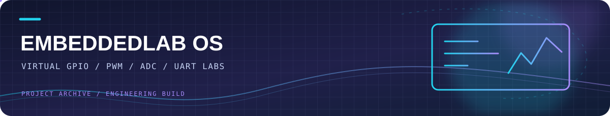
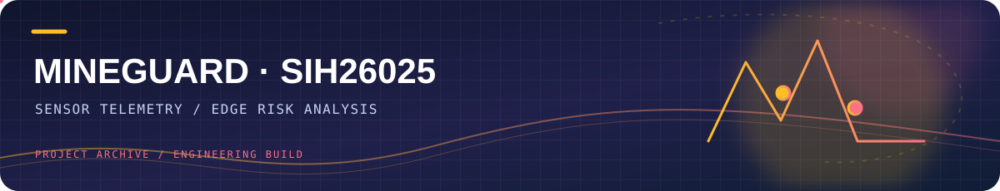
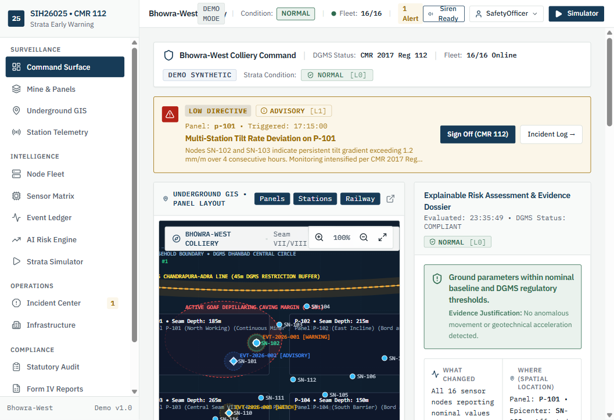
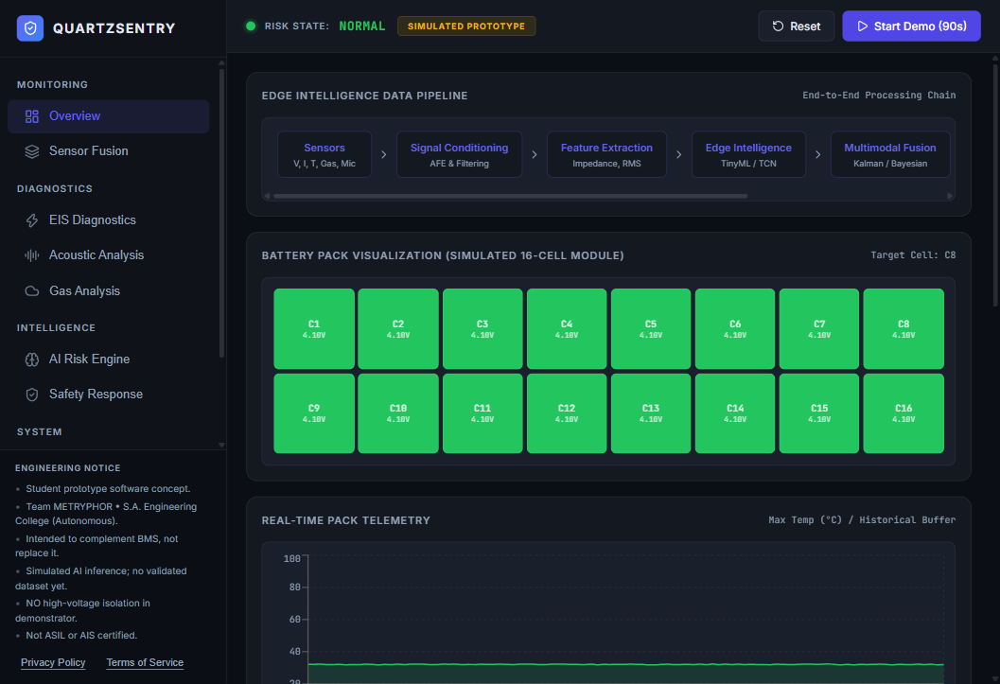

  
  
  
  

# PROJECT ARCHIVE

A visual index of selected builds, prototypes, simulations and engineering tools. Each entry links to its source repository or live demonstrator. Implementation status is stated explicitly.

---

## 01 / Featured builds

---

### LumaGuard

<strong>PHYSICAL PROTOTYPE · BENCH TESTED</strong> · Arduino Nano · ATmega328P · HC-SR04 · Flame sensor · SSD1306

A proximity and flame-hazard demonstrator with local sensing, state handling and alerts.

- HC-SR04 proximity sensing and optical flame detection feed a local hazard-state machine.
- SSD1306 OLED, LEDs and buzzer provide local status and annunciation.
- Firmware includes proximity hysteresis, flame-candidate persistence, non-blocking scheduling, stale-echo handling and EEPROM event counting.
- Project report documents **nine end-to-end bench integration scenarios**.

[Source code, wiring and test report](https://github.com/RONALD-REX-7/LumaGuard)

Educational bench demonstrator only — not a certified fire alarm or life-safety instrument. DHT22 was excluded from the final hardware baseline.

---

### EmbeddedLab OS

<strong>SOFTWARE SIMULATOR</strong> · GPIO · PWM · ADC · UART · React · Vitest

A browser-based virtual embedded laboratory for exploring microcontroller peripheral behaviour without physical hardware.

- Interactive software models for GPIO, PWM, ADC and UART, with guided labs and challenge validation.
- Deterministic peripheral-state and timing models, including ADC quantization and reference scaling.
- Scoped AI learning assistant with request validation, rate limits and deterministic offline fallback.
- Automated Vitest coverage spans simulator mathematics, challenge validators, state stores, AI route security and release invariants.

 [Source & architecture](https://github.com/RONALD-REX-7/EmbeddedLab-OS)

Educational software simulation — not a physical MCU, CPU-core emulator, transistor-level circuit simulator or hardware-validation tool.

---

### MineGuard · SIH26025

<strong>SOFTWARE PROTOTYPE · PARTIAL HARDWARE BENCH WORK · FIELD INTEGRATION INCOMPLETE</strong> · ESP32-S3 · LoRa / IN865 · Edge analytics

An edge-intelligence concept for mine-subsidence monitoring, developed around Smart India Hackathon problem statement SIH26025.

- ESP32-S3 firmware and a multi-node sensing / telemetry architecture, with LoRa IN865 communication concepts.
- Software demonstrator models deformation, tilt, strain and acoustic telemetry with a risk-analysis workflow.
- Repository reports **93% recall on 1,000 synthetic geotechnical test vectors** — a generated-data benchmark, not field performance.
- Partial bench work and firmware build evidence are documented; full multi-sensor integration and underground / field validation remain incomplete.

 [Source, architecture & evidence](https://github.com/RONALD-REX-7/sih26025)

---

## 02 / More builds

### QUARTZSENTRY

<strong>SOFTWARE DEMONSTRATOR · BATTERY EARLY WARNING</strong>

A lithium-ion battery early-warning demonstrator modelling temperature, electrochemical impedance, acoustic activity and off-gas precursor channels. Displayed telemetry is synthetic; physical transducer and analogue-front-end integration is incomplete.

[Source repository](https://github.com/RONALD-REX-7/QUARTZSENTRY)

---

### CLASSY_CS

<strong>SOFTWARE TOOLING · ACADEMIC COMPUTATION</strong>

GPA / CGPA, academic evaluation and admissions-planning engines with documented automated tests.

[Source repository](https://github.com/RONALD-REX-7/CLASSY_CS)

---

### ProblemChain / RUSH_HOUR_2026

<strong>COLLABORATIVE CIVIC-TECH HACKATHON PROTOTYPE</strong>

Collaborative project work includes scaffolding, security remediation, CI, TypeScript fixes and backend hardening.

[Source repository & contribution record](https://github.com/RONALD-REX-7/RUSH_HOUR_2026)

---

  END OF PROJECT ARCHIVE · SOURCE LINKS LEAD TO THE IMPLEMENTATIONS

