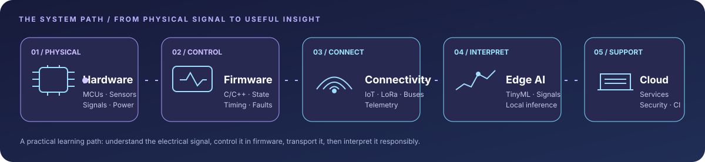
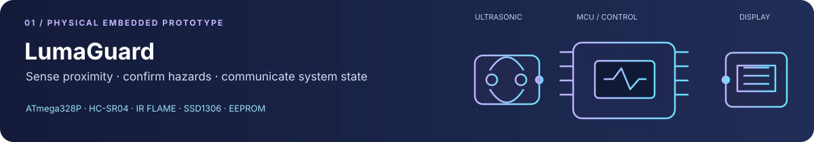
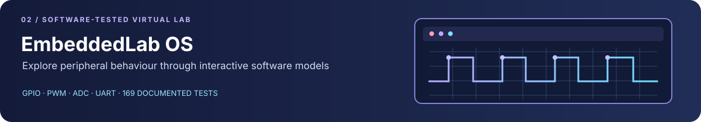
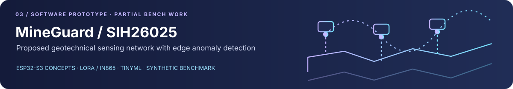
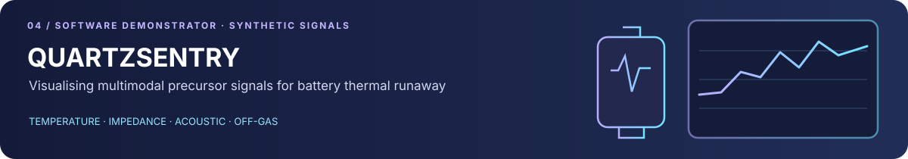
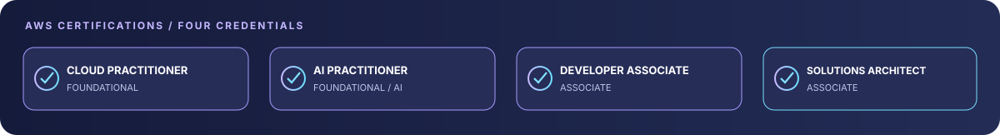
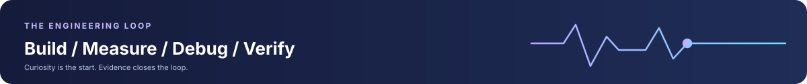

  <a href="https://www.linkedin.com/in/ron-rex">LinkedIn</a> ·
  <a href="https://www.credly.com/users/ronaldrex">AWS credentials</a> ·
  <a href="https://skillsprofile.skillbuilder.aws/user/ron">AWS Skill Builder</a> ·
  <a href="https://github.com/RONALD-REX-7">GitHub</a>

**B.E. Electronics & Communication Engineering · Class of 2028 · Chennai, India**

*From sensors and signals to dependable embedded systems.*

## 01 / The engineering direction

I’m an ECE undergraduate at **S.A. Engineering College, Chennai**, focused on **embedded systems and microcontroller firmware**. My work and learning sit close to the hardware: sensing, peripheral interfaces, firmware behaviour, debugging and verification.

My primary direction is supported by **Industrial IoT, connected-device security and cloud services**. I’m also exploring **Edge AI and TinyML** where constrained devices can benefit from local intelligence.

### What I’m building depth in

| Core engineering | Connected and intelligent systems |
|:--|:--|
| Embedded C/C++, MCU fundamentals and firmware structure | Industrial IoT, telemetry and device connectivity |
| ATmega328P, ESP32-S3 and ARM Cortex-M concepts | Edge AI, TinyML and signal processing |
| GPIO, ADC, PWM, I2C, SPI, UART and timing | Cloud platforms, application security and CI |
| State machines, fault handling, testing and debugging | System architecture and technical documentation |

**My engineering rule:** make system behaviour observable, make faults explicit, and make every performance claim traceable to evidence.

## 02 / Featured engineering work

The four projects below represent different points on the hardware–software spectrum. Their maturity labels are deliberate: a browser simulation is not an MCU emulator, synthetic telemetry is not field data, and a working demonstrator is not a certified safety system.

### 01 — LumaGuard

**PHYSICAL PROTOTYPE · HARDWARE BENCH TESTED**

**Context-aware micro-workspace proximity and hazard guard**

Arduino Nano / ATmega328P · Embedded C/C++ · PlatformIO · HC-SR04 · IR flame module · SSD1306 OLED

- Physical breadboard prototype integrating ultrasonic proximity sensing, optical flame detection, local display and audible/visual alerts.
- Firmware implements proximity hysteresis, temporal flame-candidate persistence, non-blocking scheduling, echo-fault handling and EEPROM event counting.
- The project report documents **nine end-to-end bench integration scenarios**, including intrusion, flame confirmation, alert silence, arm/disarm, hysteresis clearing, echo timeout and persistence.

[Source code, pin mapping and test report](https://github.com/RONALD-REX-7/LumaGuard)

---

### 02 — EmbeddedLab OS

**SOFTWARE TESTED · VIRTUAL LABORATORY**

**A browser-based laboratory for learning embedded fundamentals**

Next.js · TypeScript · React · Zustand · Vitest · Supabase

- Interactive software models for GPIO, PWM, ADC and UART peripheral concepts.
- Guided laboratories, challenge-based learning and deterministic validation of simulated microcontroller states.
- **169 documented Vitest tests.** The platform is an educational software simulation—not a physical MCU, CPU-core emulator or hardware-validation environment.

[Open the live laboratory](https://embeddedlab-os.vercel.app) · [Source repository](https://github.com/RONALD-REX-7/EmbeddedLab-OS)

---

### 03 — MineGuard / SIH26025

**SOFTWARE PROTOTYPE · HARDWARE INTEGRATION INCOMPLETE**

**Edge-intelligence concept for mine subsidence monitoring and early warning**

ESP32-S3 firmware concepts · LoRa / IN865 architecture · TinyML methods · Next.js · Supabase

- Proposed multi-node monitoring architecture developed around Smart India Hackathon problem statement **SIH26025**.
- Repository work includes system architecture, software components, firmware build work and a web telemetry demonstrator.
- The reported **93% recall** is a reproducible result on **1,000 synthetic geotechnical test vectors**. It is not field performance or validation on deployed mine sensors.
- Some hardware bench work is documented, but full multi-sensor integration and field validation are not complete.

[Explore the demonstrator](https://mineguard-sih26025.vercel.app) · [Source repository](https://github.com/RONALD-REX-7/sih26025)

---

### 04 — QUARTZSENTRY

**SOFTWARE DEMONSTRATOR · PHYSICAL SENSOR INTEGRATION INCOMPLETE**

**Multimodal early-warning demonstrator for lithium-ion battery thermal runaway**

React · Vite · TypeScript · SVG signal visualisation

- Models four precursor channels: temperature, electrochemical impedance, acoustic activity and off-gas readings.
- Dashboard telemetry, Nyquist curves, acoustic values and gas readings are **synthetic signals generated in software**.
- Physical transducers and analogue front-end integration remain incomplete. This is not a certified battery-management or protection system.

[Open the demonstrator](https://quartzsentry-prototype.vercel.app) · [Source repository](https://github.com/RONALD-REX-7/QUARTZSENTRY)

## 03 / Additional work

| Project | Engineering scope | Evidence and repository |
|:--|:--|:--|
| **CLASSY_CS** | Academic evaluation, GPA/CGPA calculation and admissions-planning engines. | 31 documented test assertions · [Repository](https://github.com/RONALD-REX-7/CLASSY_CS) |
| **ProblemChain / RUSH_HOUR_2026** | Collaborative civic-tech hackathon prototype. My documented repository work includes initial scaffolding, security remediation, CI, TypeScript fixes and backend hardening; team contributions are separately attributed. | [Contribution record and source](https://github.com/RONALD-REX-7/RUSH_HOUR_2026) |
| **todo-rainmeter** | Windows desktop productivity skin using Rainmeter, Lua and PowerShell, with configurable UI and animation behaviour. | [Repository and release](https://github.com/RONALD-REX-7/todo-rainmeter) |

## 04 / Tools and technologies

| Area | Current toolkit |
|:--|:--|
| **Microcontrollers** | Arduino Nano / ATmega328P, ESP32-S3; ARM Cortex-M concepts |
| **Firmware** | Embedded C/C++, PlatformIO, state machines, non-blocking scheduling, interrupts, EEPROM |
| **Interfaces** | GPIO, ADC, PWM, I2C, SPI, UART; LoRa / IN865 system concepts |
| **Edge intelligence** | Python, sensor-data analysis, MAD, EWMA, robust Z-score and TinyML exploration |
| **Cloud and application layer** | AWS, TypeScript, React, Next.js, Node.js, Supabase |
| **Engineering workflow** | Git, GitHub Actions, testing, linting, Linux, Docker and technical documentation |

*This is a practical toolkit, not a claim of equal proficiency in every technology. Some are used in projects; others are active learning areas.*

## 05 / AWS certifications

- [AWS Certified Cloud Practitioner](https://www.credly.com/badges/9176f0c6-a291-4072-a332-55abd5c9b6f8)
- [AWS Certified AI Practitioner](https://www.credly.com/badges/42dd44ed-6a82-4ee9-8733-e7bc202223b9)
- [AWS Certified Developer – Associate](https://www.credly.com/badges/5e338e11-1247-412a-926c-031eb4d5e2a4)
- [AWS Certified Solutions Architect – Associate](https://www.credly.com/badges/b662ec17-f239-48bd-b5d9-a7685d13be7a)

[View the public credential portfolio](https://www.credly.com/users/ronaldrex)

## 06 / GitHub engineering milestones & achievements

| Milestone / Badge | Status & Verifiable Metric | Engineering Scope |
| :--- | :---: | :--- |
| **Pull Shark (Bronze Tier)** | 🏆 **34 Merged PRs** | Merged 34 peer-reviewed pull requests across firmware, CI, and test repositories into default branches |
| **YOLO** | 🏆 **Unlocked** | Zero-friction rapid deployment & review-free merge qualification |
| **Quickdraw** | 🏆 **Unlocked** | Rapid triage within 5 minutes of issue/PR creation |
| **Pair Extraordinaire** | ⏳ **10 Co-Authored PRs** | Qualified Bronze Tier via collaborative multi-engine Git trailers merged into production |
| **Galaxy Brain** | 📝 **4 Active Solutions** | Detailed domain technical answers across GitHub Community and MicroPython discussions |
| **Releases & Packaging** | 📦 **4 Published Releases** | Formal semantic `v1.0.0` releases on LumaGuard, EmbeddedLab-OS, todo-rainmeter, and QUARTZSENTRY |
| **GitHub Pro** | 💜 **Active** | Verified active GitHub Pro developer account |

## 07 / Education

**B.E. Electronics and Communication Engineering**  
S.A. Engineering College · Chennai, Tamil Nadu, India  
2024–2028 · Expected graduation: **May 2028**

## 08 / What I value in engineering

- **Understand before abstracting.** Know what the sensor, peripheral or interface is doing before hiding it behind layers.
- **Verify the boundary.** Separate a successful build, a passing software test, a bench-tested circuit and a field-validated system.
- **Design for failure.** Timeouts, stale data, invalid states and recovery paths deserve explicit treatment.
- **Document for the next engineer.** Reproducible steps and honest limitations are part of the system.

I’m interested in student engineering collaborations and opportunities involving **embedded firmware, electronics, IoT, edge computing and device security**.

## 09 / Connect

<a href="https://www.linkedin.com/in/ron-rex">LinkedIn</a> ·
<a href="https://github.com/RONALD-REX-7">GitHub</a> ·
<a href="https://www.credly.com/users/ronaldrex">Credly</a> ·
<a href="https://skillsprofile.skillbuilder.aws/user/ron">AWS Skill Builder</a>

Lavender × signal blue · Built close to the hardware · Documented with evidence

