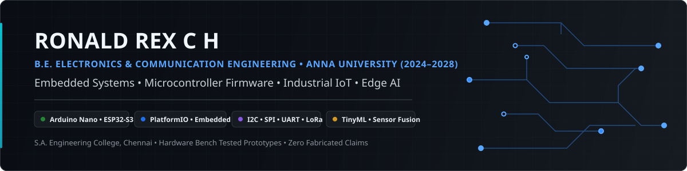
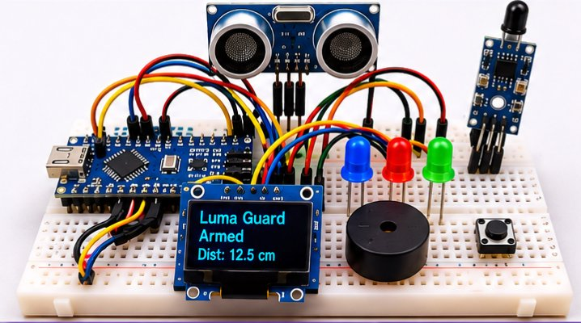

# Ronald Rex C H

  

  
  
  
  
  

---

## 1. Engineering Profile

I am an **Electronics and Communication Engineering (ECE)** undergraduate at **S.A. Engineering College (Anna University), Chennai** (Expected Graduation: **2028**). My engineering focus centers on **Embedded Systems, Microcontroller Firmware, and Industrial IoT**, with secondary focus on **Edge AI and Intelligent Hardware**.

### Core Engineering Discipline
- **Primary**: Microcontroller firmware (ATmega328P, ESP32-S3), PlatformIO, low-level register configuration, sensor arbitration, and communication bus protocols (I2C, SPI, UART, LoRa).
- **Secondary**: Edge AI and TinyML algorithms (running MAD, EWMA, robust rate-of-change) optimized for constrained microcontroller architectures.
- **Supporting**: C/C++, Python, deterministic full-stack web platforms, and cloud infrastructure.

### Zero-Fabrication Verification Guarantee
I uphold strict engineering integrity in all public work:
- Physical silicon execution on hardware test benches is explicitly differentiated from software behavioral simulations and synthetic telemetry.
- All technical benchmarks cite reproducible test harnesses and verifiable evidence tiers.

---

## 2. Featured Engineering Projects

### 1. [LumaGuard](https://github.com/RONALD-REX-7/LumaGuard)
> **Context-Aware Micro-Workspace Hazard & Proximity Guard**  
> **Target:** Arduino Nano (ATmega328P @ 16 MHz, 5V) • PlatformIO • Embedded C/C++  
> **Maturity Lifecycle:** `Stage 4: Hardware Bench Tested (Physical Breadboard Prototype)`

  

- **Physical Embedded System**: Assembled and bench-tested on an 830-point solderless breadboard with the ATmega328P Nano, 0.96" SSD1306 OLED (I2C `0x3C`), HC-SR04 ultrasonic transducer, optical IR flame sensor, passive piezo buzzer, and control pushbutton.
- **Sensory Arbitration**: Non-blocking cooperative scheduler executing bi-level distance hysteresis ($30.0\text{ cm} \to 33.0\text{ cm}$ hold), temporal optical flame candidate persistence ($250\text{ ms}$), and proportional audible urgency modulation ($900\text{ ms} \to 180\text{ ms}$).
- **Fault Detection & Memory**: Detects missing echoes (`NO ECHO` / `ZONE UNKNOWN` after $800\text{ ms}$) and persists hazard counter signatures to internal EEPROM across power cycles.
- **Deterministic Build**: Automated PlatformIO CI build matrix verifying AVR memory constraints (35.6% SRAM, 70.5% Flash).

---

### 2. [EmbeddedLab-OS](https://github.com/RONALD-REX-7/EmbeddedLab-OS) • [📋 Project Board #4](https://github.com/users/RONALD-REX-7/projects/4)
> **Deterministic Virtual Microcontroller Laboratory for ECE Education**  
> **Stack:** Next.js 16 • TypeScript • Zustand • Vitest (169 Tests) • Supabase • Apache-2.0  
> **Live System:** [embeddedlab-os.vercel.app](https://embeddedlab-os.vercel.app)  
> **Maturity Lifecycle:** `Stage 3: Software Tested (Browser-based simulator; 169 unit & integration tests passing)`

- **Register Behavioral Simulator**: Models STM32-style microcontroller peripheral registers, including GPIO electrical output states, PWM timer duty/period mathematics, ADC quantization transfer equations, and UART frame transmission.
- **Automated Validation**: 12-challenge automated student grading engine verified by 17 Vitest test suites (169 unit and integration tests passing in CI).
- **Engineering Transparency**: Explicitly scoped as an educational browser simulation tool, distinguishing register behavior from physical silicon execution and analog SPICE modeling.

---

### 3. [sih26025 (MineGuard)](https://github.com/RONALD-REX-7/sih26025) • [📋 Project Board #3](https://github.com/users/RONALD-REX-7/projects/3)
> **Industrial Edge AI & LoRa Strata Early-Warning Telemetry System**  
> **Stack:** ESP32-S3 Firmware (C++) • TinyML • Sub-GHz LoRa (IN865) • Next.js 16 • DGMS CMR 2017  
> **Live Deployment:** [mineguard-sih26025.vercel.app](https://mineguard-sih26025.vercel.app)  
> **Maturity Lifecycle:** `Stage 2: Implemented in Software (ESP32-S3 firmware & software prototype; physical hardware integration incomplete)`

- **SIH 2026 Prototype**: Software telemetry prototype engineered for Smart India Hackathon 2026 (Problem Statement ID: SIH26025) under the Ministry of Coal / Coal India Limited.
- **Firmware Architecture**: ESP32-S3 driver implementations for BNO085/MPU6050 and ADS1220 24-bit strain gauge ADC, non-blocking FreeRTOS tasks, and theoretical SX1262 LoRa link budget calculations.
- **Edge Intelligence**: On-device running MAD/EWMA anomaly scoring with adaptive reporting cadences; benchmark achieves 93.00% recall on 1,000 synthetic geomechanical test vectors.

---

### 4. [QUARTZSENTRY](https://github.com/RONALD-REX-7/QUARTZSENTRY) • [📋 Project Board #2](https://github.com/users/RONALD-REX-7/projects/2)
> **Multi-Modal Early-Warning Software Demonstrator for Li-ion Battery Thermal Runaway**  
> **Stack:** Vite • React 19 • TypeScript • Oxlint • WCAG 2.1 AA • Apache-2.0  
> **Live Demonstrator:** [quartzsentry-prototype.vercel.app](https://quartzsentry-prototype.vercel.app)  
> **Maturity Lifecycle:** `Stage 2: Implemented in Software (Academic software demonstrator with synthetic telemetry)`

- **Academic Simulation Demonstrator**: Software simulation platform modeling early-precursor thermal runaway stages in 16-cell Li-ion battery modules.
- **Multi-Modal Sensory Modeling**: Mathematical representations of Electrochemical Impedance Spectroscopy (EIS Nyquist drift), ultrasonic acoustic cavitation, off-gas emissions ($H_2$ / VOCs), and thermodynamic runaway boundaries.
- **Accessibility & Ethics**: WCAG 2.1 AA compliance (6.16:1 text contrast) with prominent disclaimers establishing that telemetry is synthetic with no physical battery pack or certified protection hardware.

---

### 5. [RUSH_HOUR_2026 (ProblemChain)](https://github.com/RONALD-REX-7/RUSH_HOUR_2026)
> **Civic Problem Verification & Startup Opportunity Ecosystem**  
> **Stack:** Express.js • React 19 • TypeScript • Tailwind CSS v4 • MongoDB • Apache-2.0  
> **Maturity Lifecycle:** `Stage 2: Implemented in Software (Rush Hour 2026 Hackathon Prototype)`

- **Collaborative Hackathon System**: Prototype bridging verified community civic grievances with local entrepreneurial contract opportunities.
- **Reconciled Contribution Matrix**: Section 2 of repository documentation explicitly separates **Git-Verified Contributions** (scaffold `a3ab592`, branch governance across 8 sprint branches, security scrubbing, CI automation, TypeScript typing, and route auth hardening) from **Owner-Reported Hackathon Work** (civic problem research, pitch deck creation, UI/API co-development, and QA testing).

---

### 6. [CLASSY_CS](https://github.com/RONALD-REX-7/CLASSY_CS)
> **Auditable Academic Evaluation, GPA/CGPA & Admissions Planning Platform**  
> **Stack:** React 19 • TypeScript • Vite • Tailwind CSS v4 • Vitest (31 Tests) • jsPDF • MIT  
> **Maturity Lifecycle:** `Stage 3: Software Tested (31 unit tests passing)`

- **Deterministic Evaluation Engine**: Computes Anna University 10-point GPA/CGPA credit-weighted evaluations with official Tamil Nadu Engineering Admissions (TNEA) 200-point reduced formulas: $\text{Cutoff} = M + \frac{P}{2} + \frac{C}{2}$.
- **Export & Type Safety**: High-resolution client-side PDF/CSV transcript generation and national entrance exam eligibility rulesets (JEE Main, JEE Advanced, NEET UG).

---

### Desktop Utilities
- **[todo-rainmeter](https://github.com/RONALD-REX-7/todo-rainmeter)**: Modern minimalist To-Do widget for Rainmeter with mathematical proportional font auto-scaling, PowerShell native Windows ColorDialog integration, persistent JSON task storage, and verified package integrity (`GPL-3.0`).

---

## 3. Embedded Systems & Firmware Architecture

My firmware development adheres to real-time embedded safety standards:
- **Low-Level Hardware Interfaces**: Register configuration, ADC sampling calibration, volatile qualifiers, bounded timing loops, and hardware watchdog timer (WDT) refresh cycles.
- **Bus Protocols**: Hardware I2C (address arbitration, clock stretching, bus recovery), SPI (clock phase/polarity modes), UART (frame buffering, ring buffers), and LoRa sub-GHz packet structures.
- **Noise Mitigation**: Temporal persistence filtering, moving average filters, and bi-level hysteresis thresholds to eliminate contact bounce and sensor chatter.

---

## 4. Edge AI & Industrial IoT Focus

Bridging physical sensor instrumentation with embedded machine learning:
- **Constrained Anomaly Scoring**: Running Median Absolute Deviation (MAD), Exponentially Weighted Moving Average (EWMA), and Robust Z-score algorithms for low-memory microcontrollers.
- **Adaptive Telemetry**: Dynamic reporting frequency scaling (reducing radio duty cycle during quiescent conditions; escalating packet rate during rapid sensor drift).
- **Geotechnical & Battery Research**: Physical link budget formulation, InSAR geospatial alignment, and multi-spectral early fault precursor identification.

---

## 5. AWS Professional Certifications

Verifiable cloud credentials earned through examination (raw validation UUIDs quarantined for privacy; official Credly badge URLs provide verifiable cryptographic proof):

| Certification | Issuing Body | Issue Date | Expiration Date | Credly Verification |
| :--- | :---: | :---: | :---: | :---: |
| **AWS Certified Cloud Practitioner** | Amazon Web Services | August 9, 2026 | August 14, 2029 | [Credly Badge](https://www.credly.com/badges/9176f0c6-a291-4072-a332-55abd5c9b6f8) |
| **AWS Certified AI Practitioner** | Amazon Web Services | August 1, 2026 | August 1, 2029 | [Credly Badge](https://www.credly.com/badges/42dd44ed-6a82-4ee9-8733-e7bc202223b9) |
| **AWS Certified Developer – Associate** | Amazon Web Services | August 14, 2026 | August 14, 2029 | [Credly Badge](https://www.credly.com/badges/5e338e11-1247-412a-926c-031eb4d5e2a4) |

---

## 6. Technical Competencies

| Domain | Competencies & Toolchains |
| :--- | :--- |
| **Microcontrollers & Hardware** | Arduino Nano (ATmega328P), ESP32-S3, STM32 / ARM Cortex-M architecture, Solderless prototyping, Voltage matching |
| **Firmware & Embedded C/C++** | PlatformIO, Arduino framework, Register manipulation, State machines, Interrupt handlers, Watchdog timers, EEPROM |
| **Communication Protocols** | I2C (`0x3C`), SPI, UART, PWM timers, Sub-GHz LoRa (SX1262 / IN865 band), LoRaWAN link budgets |
| **Edge AI & Signal Analysis** | Running MAD, EWMA, Robust Z-score rate-of-change, Sensor fusion, Scikit-learn (Isolation Forest) |
| **Software & Web Platforms** | TypeScript, React 19, Next.js (App Router), Express.js, Zustand, Supabase (PostgreSQL, RLS) |
| **DevSecOps & Testing Quality** | GitHub Actions CI/CD, PlatformIO CI matrix, Vitest, Jest, Oxlint, ESLint, WCAG 2.1 AA |

---

## 7. Education

- **Bachelor of Engineering (B.E.) in Electronics and Communication Engineering**  
  **Institution:** S.A. Engineering College (Affiliated to Anna University), Chennai  
  **Duration:** 2024 – 2028 (Expected Graduation: **2028**)  
  **Core Coursework:** Electronic Circuits, Digital Logic Design, Microcontrollers & Microprocessors, Signals & Systems, Linear Integrated Circuits, Communication Engineering, Computer Architecture.

---

## 8. Public GitHub Project Boards

Live technical roadmaps, issue backlogs, and hardware validation tracking are publicly available across three boards:

1. **[Board 4: EmbeddedLab OS](https://github.com/users/RONALD-REX-7/projects/4)** — Microcontroller firmware architecture, virtual peripheral register modeling, and educational simulator roadmap.
2. **[Board 3: SIH 2026 · MineGuard](https://github.com/users/RONALD-REX-7/projects/3)** — Mine strata monitoring architecture, LoRa packet telemetry, and Edge AI anomaly detection backlog.
3. **[Board 2: QUARTZSENTRY](https://github.com/users/RONALD-REX-7/projects/2)** — Battery thermal runaway simulation milestones, WCAG 2.1 AA accessibility, and sensor fusion models.

---

## 9. Verified External Profiles & Contact

- **LinkedIn**: [linkedin.com/in/ron-rex](https://www.linkedin.com/in/ron-rex)
- **Credly Profile**: [credly.com/users/ronaldrex](https://www.credly.com/users/ronaldrex)
- **AWS Skill Builder**: [skillsprofile.skillbuilder.aws/user/ron](https://skillsprofile.skillbuilder.aws/user/ron)
- **GitHub Discussions / Collaboration**: [@RONALD-REX-7](https://github.com/RONALD-REX-7)
