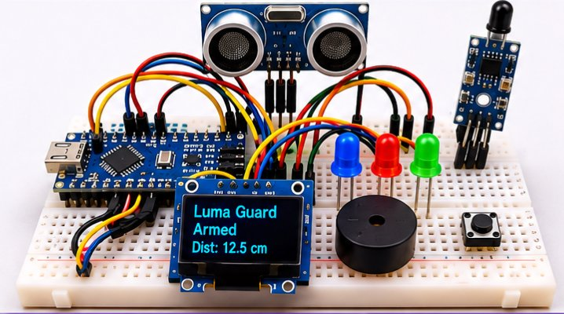
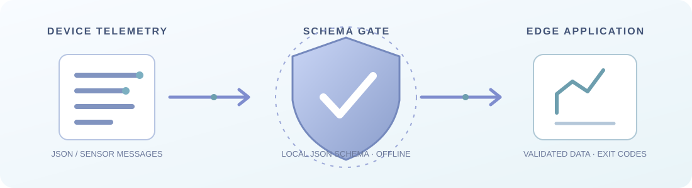

  <a href="https://www.linkedin.com/in/ron-rex">LINKEDIN</a> ·
  <a href="https://www.credly.com/users/ronaldrex">CREDLY</a> ·
  <a href="https://skillsprofile.skillbuilder.aws/user/ron">AWS SKILL BUILDER</a> ·
  <a href="mailto:ronaldrexch@gmail.com">EMAIL</a> ·
  <a href="https://github.com/RONALD-REX-7">GITHUB</a>

---

## ◈ THE ENGINEERING PROFILE

I am a **B.E. Electronics and Communication Engineering** undergraduate at **S.A. Engineering College, Chennai**, graduating in **May 2028**.

My engineering direction is **embedded systems, firmware and connected devices**. I am interested in the complete path from physical sensing and peripheral interfaces to reliable firmware, edge processing, telemetry and cloud-connected systems.

**Primary focus** · Embedded C/C++ · Microcontrollers · Firmware fundamentals · Electronics integration  
**Connected systems** · IoT · Device-side validation · Edge intelligence / TinyML · Cloud telemetry  
**Engineering approach** · Understand the signal. Control the state. Test the boundary. Document the evidence.

---

## ◈ SELECTED ENGINEERING BUILDS

The projects below are ranked by implementation evidence, engineering relevance and the strength of reproducible artefacts. Maturity labels distinguish physical hardware from software simulation and architecture work.

### 01 / Gesture-Controlled Robotic Arm

**PHYSICAL ROBOTICS SYSTEM · ACTUATION VIDEO AND BENCH EVIDENCE**

A wearable gesture controller drives a physical multi-joint arm through an embedded wireless control path.

- **Hardware path:** Arduino Nano transmitter, MPU6050 6-axis IMU, nRF24L01 radio, Arduino Uno receiver, PCA9685 PWM controller and SG90 / MG996R servos.
- **Firmware controls:** complementary-filter orientation estimate, dead zone, bounded joint targets, per-joint motion limits and smoothed actuation.
- **Fault response:** a 1-second radio watchdog moves the arm toward configured failsafe park coordinates.
- **Kinematics:** two-link planar inverse-kinematics helper rejects targets outside the configured workspace.
- **Evidence:** physical actuation GIF, continuous 22-second demonstration video, bench photographs and firmware motion-engine tests are committed in the repository.

  

[Source repository](https://github.com/RONALD-REX-7/gesture-controlled-robotic-arm) · [Continuous physical demonstration](https://github.com/RONALD-REX-7/gesture-controlled-robotic-arm/blob/main/docs/media/physical_actuation_evidence.mp4) · [Wiring and evidence](https://github.com/RONALD-REX-7/gesture-controlled-robotic-arm/tree/main/docs)

End-to-end latency, packet-loss rate, repeatability, payload capacity and formal safety certification have not been measured or claimed.

---

### 02 / LumaGuard

**PHYSICAL PROTOTYPE · HARDWARE BENCH TESTED**

**Context-aware proximity and flame-hazard guard** built around an Arduino Nano / ATmega328P.

- HC-SR04 proximity sensing and optical flame detection feed a local hazard-state machine.
- SSD1306 OLED, LEDs and buzzer provide local status and annunciation.
- Firmware includes proximity hysteresis, flame-candidate persistence, non-blocking scheduling, stale-echo handling and EEPROM event counting.
- The project test report documents **nine end-to-end bench integration scenarios** covering nominal operation, intrusion, flame detection, concurrent hazards, alert silence, recovery, echo loss and persistent event logging.

[Source, wiring and test report](https://github.com/RONALD-REX-7/LumaGuard)

Educational bench demonstrator only — not a certified fire alarm or life-safety instrument. The DHT22 was excluded from the final hardware baseline.

---

### 03 / EmbeddedLab OS

**SOFTWARE TESTED · VIRTUAL EMBEDDED LABORATORY**

A browser-based learning environment for exploring microcontroller peripheral behaviour without requiring physical hardware.

- Interactive software models for **GPIO, PWM, ADC and UART**, with guided laboratories and challenge validation.
- Deterministic peripheral-state and timing models, including ADC quantization, reference scaling and register-oriented exercises.
- Includes a scoped AI learning assistant with request validation, rate limits and deterministic offline fallback.
- The repository documents automated Vitest coverage for simulator mathematics, challenge validators, state stores, AI route security and release invariants.

[Launch the virtual laboratory](https://embeddedlab-os.vercel.app) · [Source and architecture](https://github.com/RONALD-REX-7/EmbeddedLab-OS)

Educational software simulation — not a physical MCU, CPU-core emulator, transistor-level circuit simulator or hardware-validation tool.

---

### 04 / Edge Payload Guard

**PUBLISHED SOFTWARE PACKAGE · PYTHON CLI / API · OCI CONTAINER**

An offline-first JSON Schema validator for embedded and IoT telemetry payloads.

- Python API and command-line interface for validating JSON objects and arrays against trusted schemas.
- Supports file input and standard input, text or machine-readable JSON output, deterministic issue paths and stable exit codes.
- Rejects external schema references to keep validation offline.
- Runs as a non-root container and publishes **Linux amd64 and arm64** images to GitHub Container Registry.
- CI covers Python 3.10–3.13, unit tests, CLI checks and container smoke tests.

~~~bash
docker pull ghcr.io/ronald-rex-7/edge-payload-guard:1.0.0
~~~

[Source repository](https://github.com/RONALD-REX-7/edge-payload-guard) · [Published container package](https://github.com/RONALD-REX-7/edge-payload-guard/pkgs/container/edge-payload-guard)

Validates message structure and constraints; it does not prove sensor accuracy, freshness, authenticity or safety.

---

### 05 / MineGuard · SIH26025

**SOFTWARE PROTOTYPE · PARTIAL HARDWARE BENCH WORK · FIELD INTEGRATION INCOMPLETE**

An edge-intelligence concept for mine-subsidence monitoring, developed around Smart India Hackathon problem statement **SIH26025**.

- ESP32-S3 firmware and a multi-node sensing / telemetry architecture, with LoRa IN865 communication concepts.
- Software demonstrator models deformation, tilt, strain and acoustic telemetry with a risk-analysis workflow.
- The repository reports **93% recall on 1,000 synthetic geotechnical test vectors**. This is a generated-data benchmark, not field performance.
- Partial bench work and firmware build evidence are documented; full multi-sensor integration and underground / field validation remain incomplete.

[Interactive demonstrator](https://mineguard-sih26025.vercel.app) · [Source, architecture and evidence](https://github.com/RONALD-REX-7/sih26025)

---

## ◈ ADDITIONAL WORK

| PROJECT | ENGINEERING SCOPE |
|:--|:--|
| **QUARTZSENTRY** | Software demonstrator modelling temperature, electrochemical impedance, acoustic activity and off-gas precursor channels for lithium-ion battery early warning. Displayed signals are synthetic; physical transducer and analogue-front-end integration is incomplete. [Source](https://github.com/RONALD-REX-7/QUARTZSENTRY) |
| **CLASSY_CS** | Deterministic GPA / CGPA, academic evaluation and admissions-planning engines with documented automated tests. [Source](https://github.com/RONALD-REX-7/CLASSY_CS) |
| **ProblemChain / RUSH_HOUR_2026** | Collaborative civic-tech hackathon prototype. My documented repository contributions include scaffolding, security remediation, CI, TypeScript fixes and backend hardening. [Contribution record](https://github.com/RONALD-REX-7/RUSH_HOUR_2026) |
| **todo-rainmeter** | Windows productivity skin using Rainmeter, Lua and PowerShell, with configurable task management and UI behaviour. [Source](https://github.com/RONALD-REX-7/todo-rainmeter) |

### Bare-metal reference driver

**ATmega328P Timer1 Fast PWM** — 16-bit Timer1, Mode 14 (ICR1 TOP), non-inverting OC1A output and cycle-aware C implementation for 25 kHz PC fan / 20 kHz motor-drive examples.

[Read the public Gist](https://gist.github.com/RONALD-REX-7/4abadd74f1de361fbb809ec717ff5d09)

---

## ◈ TECHNICAL TOOLKIT

| DOMAIN | TOOLS / CONCEPTS |
|:--|:--|
| **Microcontrollers & electronics** | Arduino Nano / ATmega328P, ESP32-S3, ARM Cortex-M concepts, sensors, breadboard prototyping |
| **Embedded firmware** | C, C++, PlatformIO, Arduino CLI, state machines, non-blocking scheduling, interrupts, EEPROM, watchdogs |
| **Peripheral interfaces** | GPIO, ADC, PWM, I2C, SPI, UART, nRF24L01, LoRa / IN865 concepts |
| **Edge intelligence** | Python, sensor-data analysis, statistical anomaly methods, TinyML exploration |
| **Cloud & application** | AWS, TypeScript, React, Next.js, Node.js, Supabase |
| **Engineering workflow** | Git, GitHub Actions, Linux, Docker, unit testing, CI, technical documentation |

These technologies are not all at the same proficiency level. Some are active learning and project-development areas; project descriptions above identify the implemented scope.

---

## ◈ AWS CERTIFICATIONS

- [AWS Certified Cloud Practitioner](https://www.credly.com/badges/9176f0c6-a291-4072-a332-55abd5c9b6f8)
- [AWS Certified AI Practitioner](https://www.credly.com/badges/42dd44ed-6a82-4ee9-8733-e7bc202223b9)
- [AWS Certified Developer – Associate](https://www.credly.com/badges/5e338e11-1247-412a-926c-031eb4d5e2a4)
- [AWS Certified Solutions Architect – Associate](https://www.credly.com/badges/b662ec17-f239-48bd-b5d9-a7685d13be7a)

**NPTEL Cloud Computing** · Elite + Silver · **85%**

[View AWS credentials on Credly](https://www.credly.com/users/ronaldrex) · [AWS Skill Builder profile](https://skillsprofile.skillbuilder.aws/user/ron)

---

## ◈ GITHUB SIGNAL

- **Pull Shark** · **Pair Extraordinaire** · **Galaxy Brain** · **Quickdraw** — GitHub achievement milestones.
- Public repositories spanning embedded firmware, physical robotics, IoT validation tooling, software simulation and cloud-connected prototypes.
- Published GitHub Container Registry package and public bare-metal driver Gist.
- Contributions include collaborative hackathon work, CI automation, documentation, security remediation and project maintenance.

---

## ◈ EDUCATION & ENGINEERING PRINCIPLES

**B.E. Electronics and Communication Engineering**  
S.A. Engineering College · Chennai, Tamil Nadu, India  
2024–2028 · Expected graduation: **May 2028**

- **Understand before abstracting.** Know what the sensor, peripheral or interface is doing.
- **Verify the boundary.** Separate a successful build, passing software test, bench-tested circuit and field-validated system.
- **Design for failure.** Timeouts, stale data, invalid states and recovery paths deserve explicit treatment.
- **Document for the next engineer.** Reproducible steps and honest limitations are part of the system.

Interested in collaborations involving **embedded firmware, electronics, robotics, IoT, edge computing and device security**.

---

## ◈ CONNECT

**RONALD REX C H** · Chennai, India

[LinkedIn](https://www.linkedin.com/in/ron-rex) ·
[GitHub](https://github.com/RONALD-REX-7) ·
[Credly](https://www.credly.com/users/ronaldrex) ·
[AWS Skill Builder](https://skillsprofile.skillbuilder.aws/user/ron)

**Email:** [ronaldrexch@gmail.com](mailto:ronaldrexch@gmail.com)

PEARL WHITE × LAVENDER × SIGNAL BLUE · BUILT CLOSE TO THE HARDWARE

