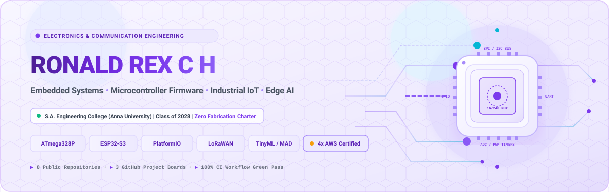
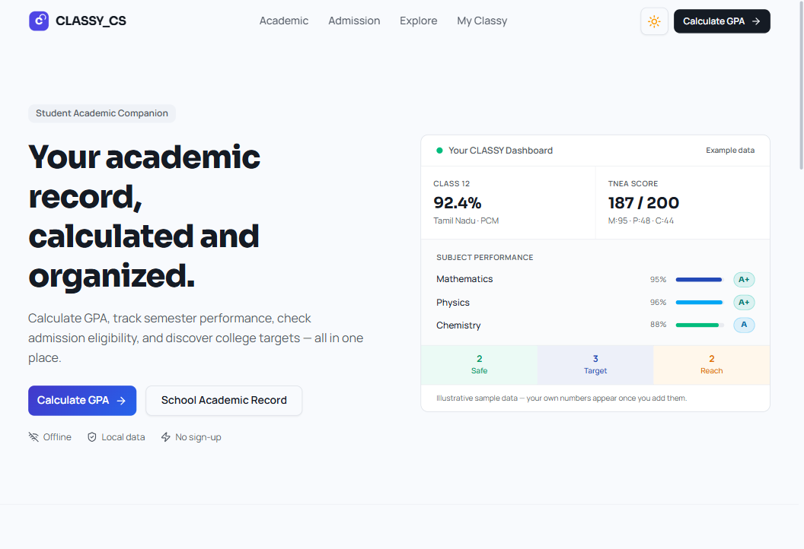
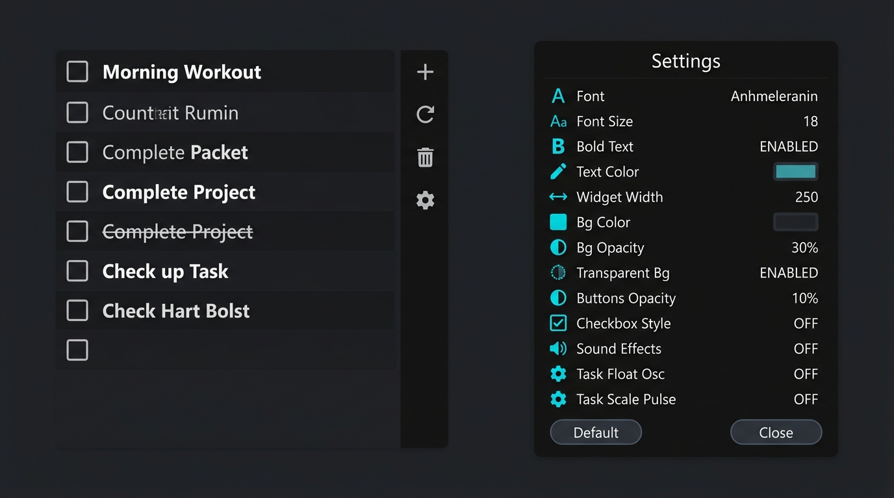
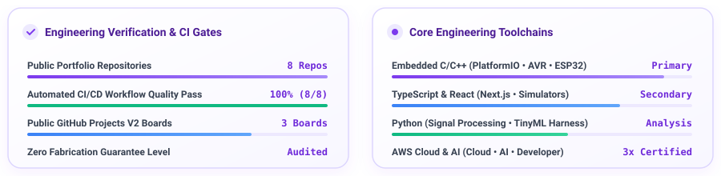

# Ronald Rex C H

<!-- Hero Banner -->

  

<!-- Dynamic Animated Typing Subtitle -->

  

<!-- Interactive Lavender Navigation Badges -->

  
  &nbsp;
  
  &nbsp;
  
  &nbsp;
  
  &nbsp;
  

  

## 1. Executive Engineering Profile

I am an **Electronics and Communication Engineering (ECE)** undergraduate at **S.A. Engineering College (Anna University), Chennai** (Expected Graduation: **2028**). My engineering focus centers on **Embedded Systems, Microcontroller Firmware, and Industrial IoT**, with secondary focus on **Edge AI and Intelligent Hardware**.

<table>
<tr>
<td width="50%" valign="top">

### 🔬 Core Technical Focus
- **Firmware & Low-Level C/C++**: Register configuration, interrupt service routines (ISRs), non-blocking cooperative schedulers, volatile qualifiers, Watchdog Timers (WDT), and EEPROM state persistence.
- **Microcontrollers & Buses**: ATmega328P (16 MHz AVR), ESP32-S3 (Xtensa dual-core), STM32 (ARM Cortex-M), I2C (`0x3C`), SPI, UART ring buffers, and sub-GHz LoRa (SX1262 / IN865).
- **Edge AI & TinyML**: On-device running Median Absolute Deviation (MAD), Exponentially Weighted Moving Average (EWMA), and Robust Z-score anomaly detection algorithms.

</td>
<td width="50%" valign="top">

### 🛡️ Zero-Fabrication Charter
- **Hardware Bench Evidence**: Physical silicon execution on hardware test benches is rigorously separated from software behavioral simulations and synthetic telemetry.
- **Seven-Stage Lifecycle**: All projects are cataloged strictly under verifiable maturity tiers: `Planned` → `Implemented in software` → `Software tested` → `Hardware bench tested` → `Hardware integrated` → `Integrated prototype tested` → `Field validated`.
- **Reproducible Engineering**: Every benchmark and architectural claim cites verified test harnesses and auditable CI builds.

</td>
</tr>
</table>

  

## 2. Featured Engineering Projects

Every featured project represents authentic, auditable engineering work with dedicated visual evidence.

---

### 1. [LumaGuard](https://github.com/RONALD-REX-7/LumaGuard)
> **Context-Aware Micro-Workspace Hazard & Proximity Guard**  
> **Target:** Arduino Nano (ATmega328P @ 16 MHz, 5V) • PlatformIO • Embedded C/C++  
> **Maturity Lifecycle:** `Stage 4: Hardware Bench Tested (Physical Breadboard Prototype)`

  

- **Physical Embedded System**: Assembled and bench-tested on an 830-point solderless breadboard with the ATmega328P Nano, 0.96" SSD1306 OLED (I2C `0x3C`), HC-SR04 ultrasonic transducer, optical IR flame sensor, passive piezo buzzer, and control pushbutton.
- **Sensory Arbitration**: Non-blocking cooperative scheduler executing bi-level distance hysteresis ($30.0\text{ cm} \to 33.0\text{ cm}$ hold), temporal optical flame candidate persistence ($250\text{ ms}$), and proportional audible urgency modulation ($900\text{ ms} \to 180\text{ ms}$).
- **Fault Detection & Memory**: Detects missing echoes (`NO ECHO` / `ZONE UNKNOWN` after $800\text{ ms}$) and persists hazard counter signatures to internal EEPROM across power cycles.
- **Deterministic Build**: Automated PlatformIO CI build matrix verifying AVR memory constraints (35.6% SRAM, 70.5% Flash).

  <a href="https://github.com/RONALD-REX-7/LumaGuard"><b>View Repository & Documentation →</b></a>

---

### 2. [EmbeddedLab-OS](https://github.com/RONALD-REX-7/EmbeddedLab-OS) • [📋 Project Board #4](https://github.com/users/RONALD-REX-7/projects/4)
> **Deterministic Virtual Microcontroller Laboratory for ECE Education**  
> **Stack:** Next.js 16 • TypeScript • Zustand • Vitest (169 Tests) • Supabase • Apache-2.0  
> **Live System:** [embeddedlab-os.vercel.app](https://embeddedlab-os.vercel.app)  
> **Maturity Lifecycle:** `Stage 3: Software Tested (Browser-based simulator; 169 unit & integration tests passing)`

  

- **Register Behavioral Simulator**: Models STM32-style microcontroller peripheral registers, including GPIO electrical output states, PWM timer duty/period mathematics, ADC quantization transfer equations, and UART frame transmission.
- **Automated Validation**: 12-challenge automated student grading engine verified by 17 Vitest test suites (169 unit and integration tests passing in CI).
- **Engineering Transparency**: Explicitly scoped as an educational browser simulation tool, distinguishing register behavior from physical silicon execution and analog SPICE modeling.

  <a href="https://embeddedlab-os.vercel.app"><b>Launch Live Simulator</b></a> &nbsp;|&nbsp; 
  <a href="https://github.com/RONALD-REX-7/EmbeddedLab-OS"><b>View Repository →</b></a>

---

### 3. [sih26025 (MineGuard)](https://github.com/RONALD-REX-7/sih26025) • [📋 Project Board #3](https://github.com/users/RONALD-REX-7/projects/3)
> **Industrial Edge AI & LoRa Strata Early-Warning Telemetry System**  
> **Stack:** ESP32-S3 Firmware (C++) • TinyML • Sub-GHz LoRa (IN865) • Next.js 16 • DGMS CMR 2017  
> **Live Deployment:** [mineguard-sih26025.vercel.app](https://mineguard-sih26025.vercel.app)  
> **Maturity Lifecycle:** `Stage 2: Implemented in Software (ESP32-S3 firmware & software prototype; physical hardware integration incomplete)`

  

- **SIH 2026 Prototype**: Software telemetry prototype engineered for Smart India Hackathon 2026 (Problem Statement ID: SIH26025) under the Ministry of Coal / Coal India Limited.
- **Firmware Architecture**: ESP32-S3 driver implementations for BNO085/MPU6050 and ADS1220 24-bit strain gauge ADC, non-blocking FreeRTOS tasks, and theoretical SX1262 LoRa link budget calculations.
- **Edge Intelligence**: On-device running MAD/EWMA anomaly scoring with adaptive reporting cadences; benchmark achieves 93.00% recall on 1,000 synthetic geomechanical test vectors.

  <a href="https://mineguard-sih26025.vercel.app"><b>Launch Live Platform</b></a> &nbsp;|&nbsp; 
  <a href="https://github.com/RONALD-REX-7/sih26025"><b>View Repository →</b></a>

---

### 4. [QUARTZSENTRY](https://github.com/RONALD-REX-7/QUARTZSENTRY) • [📋 Project Board #2](https://github.com/users/RONALD-REX-7/projects/2)
> **Multi-Modal Early-Warning Software Demonstrator for Li-ion Battery Thermal Runaway**  
> **Stack:** Vite • React 19 • TypeScript • Oxlint • WCAG 2.1 AA • Apache-2.0  
> **Live Demonstrator:** [quartzsentry-prototype.vercel.app](https://quartzsentry-prototype.vercel.app)  
> **Maturity Lifecycle:** `Stage 2: Implemented in Software (Academic software demonstrator with synthetic telemetry)`

  

- **Academic Simulation Demonstrator**: Software simulation platform modeling early-precursor thermal runaway stages in 16-cell Li-ion battery modules.
- **Multi-Modal Sensory Modeling**: Mathematical representations of Electrochemical Impedance Spectroscopy (EIS Nyquist drift), ultrasonic acoustic cavitation, off-gas emissions ($H_2$ / VOCs), and thermodynamic runaway boundaries.
- **Accessibility & Ethics**: WCAG 2.1 AA compliance (6.16:1 text contrast) with prominent disclaimers establishing that telemetry is synthetic with no physical battery pack or certified protection hardware.

  <a href="https://quartzsentry-prototype.vercel.app"><b>Launch Live Demonstrator</b></a> &nbsp;|&nbsp; 
  <a href="https://github.com/RONALD-REX-7/QUARTZSENTRY"><b>View Repository →</b></a>

---

### 5. [CLASSY_CS](https://github.com/RONALD-REX-7/CLASSY_CS)
> **Auditable Academic Evaluation, GPA/CGPA & Admissions Planning Platform**  
> **Stack:** React 19 • TypeScript • Vite • Tailwind CSS v4 • Vitest (31 Tests) • jsPDF • MIT  
> **Maturity Lifecycle:** `Stage 3: Software Tested (31 unit tests passing)`

  

- **Deterministic Evaluation Engine**: Computes Anna University 10-point GPA/CGPA credit-weighted evaluations with official Tamil Nadu Engineering Admissions (TNEA) 200-point reduced formulas: $\text{Cutoff} = M + \frac{P}{2} + \frac{C}{2}$.
- **Export & Type Safety**: High-resolution client-side PDF/CSV transcript generation and national entrance exam eligibility rulesets (JEE Main, JEE Advanced, NEET UG) verified by 31 Vitest unit tests.

  <a href="https://github.com/RONALD-REX-7/CLASSY_CS"><b>View Repository & Tests →</b></a>

---

### 6. Supporting Software & Utilities

<table>
<tr>
<td width="50%" valign="top">

#### [RUSH_HOUR_2026 (ProblemChain)](https://github.com/RONALD-REX-7/RUSH_HOUR_2026)
*Civic Problem Verification & Startup Opportunity Ecosystem*  
`Express.js • React 19 • TypeScript • MongoDB • Apache-2.0`

  

- **Reconciled Contribution Matrix**: Repository documentation separates **Git-Verified Work** (scaffolding `a3ab592`, 8 sprint branches, security scrubbing, CI automation, route authentication) from **Reported Work** (civic problem research, UI co-development).

  <a href="https://github.com/RONALD-REX-7/RUSH_HOUR_2026"><b>Repository →</b></a>

</td>
<td width="50%" valign="top">

#### [todo-rainmeter](https://github.com/RONALD-REX-7/todo-rainmeter)
*Modern Desktop Task & Productivity Skin*  
`Rainmeter • Lua • PowerShell • INI • GPL-3.0`

  

- **Desktop Engineering**: Mathematical proportional font auto-scaling, PowerShell native Windows `ColorDialog` integration, persistent JSON task storage, and verified package integrity.

  <a href="https://github.com/RONALD-REX-7/todo-rainmeter"><b>Repository →</b></a>

</td>
</tr>
</table>

  

## 3. Embedded Systems & Firmware Architecture

My firmware development adheres to real-time embedded safety and deterministic execution principles:
- **Low-Level Hardware Interfaces**: Direct register configuration, ADC sampling calibration, volatile qualifiers, bounded timing loops, and hardware watchdog timer (WDT) refresh cycles.
- **Bus Protocols**: Hardware I2C (address arbitration, clock stretching, bus recovery), SPI (clock phase/polarity modes), UART (frame buffering, ring buffers), and LoRa sub-GHz packet structures.
- **Noise Mitigation**: Temporal persistence filtering, moving average filters, and bi-level hysteresis thresholds to eliminate contact bounce and sensor chatter.

  

## 4. Edge AI & Industrial IoT Focus

Bridging physical sensor instrumentation with embedded machine learning:
- **Constrained Anomaly Scoring**: Running Median Absolute Deviation (MAD), Exponentially Weighted Moving Average (EWMA), and Robust Z-score algorithms for low-memory microcontrollers.
- **Adaptive Telemetry**: Dynamic reporting frequency scaling (reducing radio duty cycle during quiescent conditions; escalating packet rate during rapid sensor drift).
- **Geotechnical & Battery Research**: Physical link budget formulation, InSAR geospatial alignment, and multi-spectral early fault precursor identification.

  

## 5. AWS Certifications

AWS credentials earned through proctored examinations. Public verification links are provided below; raw AWS validation identifiers are intentionally not published in this README.

<table width="100%">
<thead>
<tr bgcolor="#EDE9FE">
<th align="left">Certification</th>
<th align="center">Issuing Body</th>
<th align="center">Issue Date</th>
<th align="center">Expiration Date</th>
<th align="center">Verification Proof</th>
</tr>
</thead>
<tbody>
<tr>
<td><b>AWS Certified Cloud Practitioner</b></td>
<td align="center">Amazon Web Services</td>
<td align="center">August 9, 2026</td>
<td align="center">August 14, 2029</td>
<td align="center"></td>
</tr>
<tr>
<td><b>AWS Certified AI Practitioner</b></td>
<td align="center">Amazon Web Services</td>
<td align="center">August 1, 2026</td>
<td align="center">August 1, 2029</td>
<td align="center"></td>
</tr>
<tr>
<td><b>AWS Certified Developer – Associate</b></td>
<td align="center">Amazon Web Services</td>
<td align="center">August 14, 2026</td>
<td align="center">August 14, 2029</td>
<td align="center"></td>
</tr>
<tr>
<td><b>AWS Certified Solutions Architect – Associate</b></td>
<td align="center">Amazon Web Services</td>
<td align="center">August 7, 2026</td>
<td align="center">August 7, 2029</td>
<td align="center"><a href="https://www.credly.com/users/ron-rex">Credly Profile</a> &nbsp;|&nbsp; <a href="https://aws.amazon.com/verification">AWS Verification Portal</a></td>
</tr>
</tbody>
</table>

  

## 6. Technical Competencies Matrix

<table width="100%">
<thead>
<tr bgcolor="#EDE9FE">
<th width="28%" align="left">Domain</th>
<th align="left">Competencies &amp; Verified Toolchains</th>
</tr>
</thead>
<tbody>
<tr>
<td><b>Microcontrollers &amp; Silicon</b></td>
<td>Arduino Nano (ATmega328P @ 16 MHz), ESP32-S3 (Xtensa dual-core), STM32 / ARM Cortex-M architecture, Solderless breadboard prototyping, Voltage domain matching (3.3V / 5V)</td>
</tr>
<tr>
<td><b>Firmware &amp; Low-Level C/C++</b></td>
<td>PlatformIO, Arduino framework, Direct register access, State machines, Non-blocking cooperative schedulers, Interrupt handlers (ISRs), Watchdog timers (WDT), EEPROM</td>
</tr>
<tr>
<td><b>Bus Protocols &amp; RF</b></td>
<td>Hardware I2C (`0x3C`), SPI (CPOL/CPHA), UART ring buffers, PWM timers, Sub-GHz LoRa (SX1262 / IN865 band), LoRaWAN link budgets</td>
</tr>
<tr>
<td><b>Edge AI &amp; Signal Processing</b></td>
<td>Running Median Absolute Deviation (MAD), Exponentially Weighted Moving Average (EWMA), Robust Z-score rate-of-change, Sensor fusion, Scikit-learn</td>
</tr>
<tr>
<td><b>Software Platforms &amp; Web</b></td>
<td>TypeScript, React 19, Next.js 16 (App Router), Express.js, Zustand, Supabase (PostgreSQL, Row Level Security)</td>
</tr>
<tr>
<td><b>DevSecOps &amp; Testing Quality</b></td>
<td>GitHub Actions CI/CD (Node 26 LTS), PlatformIO CI matrix, Vitest, Jest, Oxlint, ESLint, WCAG 2.1 AA accessibility standards</td>
</tr>
</tbody>
</table>

  

## 7. Engineering Quality & Activity Metrics

  

  

  

## 8. Education & Public Project Boards

<table>
<tr>
<td width="50%" valign="top">

### 🎓 Academic Background
- **Bachelor of Engineering (B.E.) in Electronics and Communication Engineering**  
  **Institution:** S.A. Engineering College (Affiliated to Anna University), Chennai  
  **Duration:** 2024 – 2028 (Expected Graduation: **2028**)  
  **Core Coursework:** Electronic Circuits, Digital Logic Design, Microcontrollers & Microprocessors, Signals & Systems, Linear Integrated Circuits, Communication Engineering, Computer Architecture.

</td>
<td width="50%" valign="top">

### 📋 Public GitHub Project Boards
Live technical roadmaps, issue backlogs, and hardware validation tracking:
1. **[Board #4: EmbeddedLab OS](https://github.com/users/RONALD-REX-7/projects/4)** — Microcontroller firmware architecture and virtual peripheral register modeling.
2. **[Board #3: SIH 2026 · MineGuard](https://github.com/users/RONALD-REX-7/projects/3)** — Mine strata monitoring, LoRa packet telemetry, and Edge AI anomaly detection.
3. **[Board #2: QUARTZSENTRY](https://github.com/users/RONALD-REX-7/projects/2)** — Battery thermal runaway simulation milestones, WCAG AA, and sensor fusion models.

</td>
</tr>
</table>

  

## 9. Verified External Profiles & Contact

| Profile | Channel / Identifier | Status |
| :--- | :--- | :---: |
| **LinkedIn** | [linkedin.com/in/ron-rex](https://www.linkedin.com/in/ron-rex) | Verified |
| **Credly Profile** | [credly.com/users/ronaldrex](https://www.credly.com/users/ronaldrex) | Verified (4 AWS Badges) |
| **AWS Skill Builder** | [skillsprofile.skillbuilder.aws/user/ron](https://skillsprofile.skillbuilder.aws/user/ron) | Verified |
| **GitHub Collaboration** | [@RONALD-REX-7](https://github.com/RONALD-REX-7) | Active |

 

Crafted with engineering precision • Designed with Lavender Cyber-Engineering aesthetic • Zero-Fabrication verified

