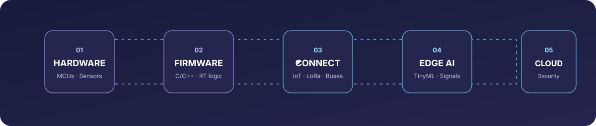
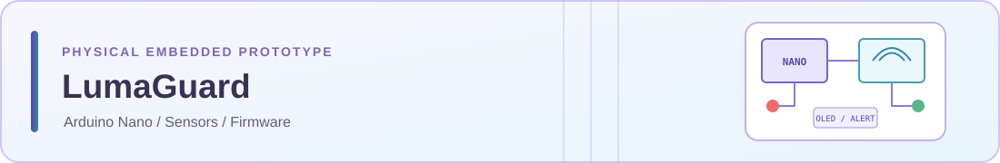
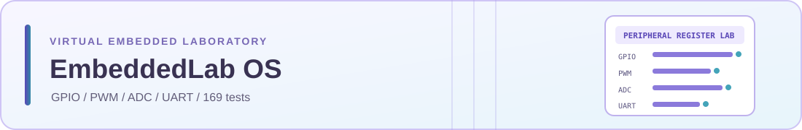
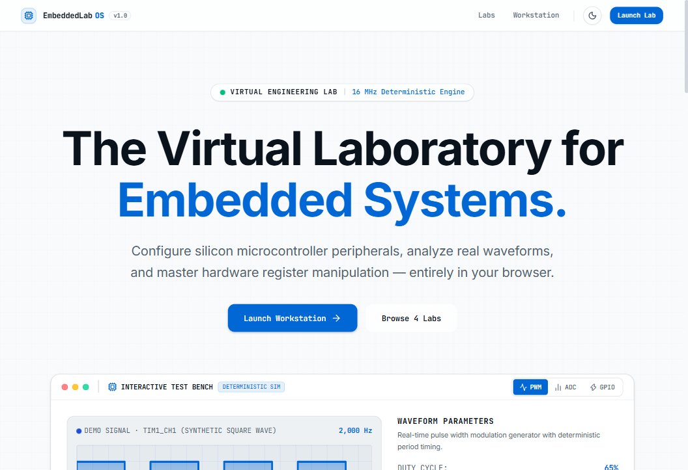
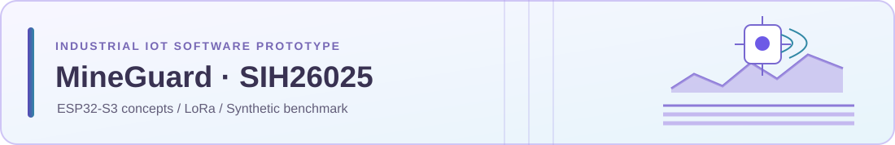
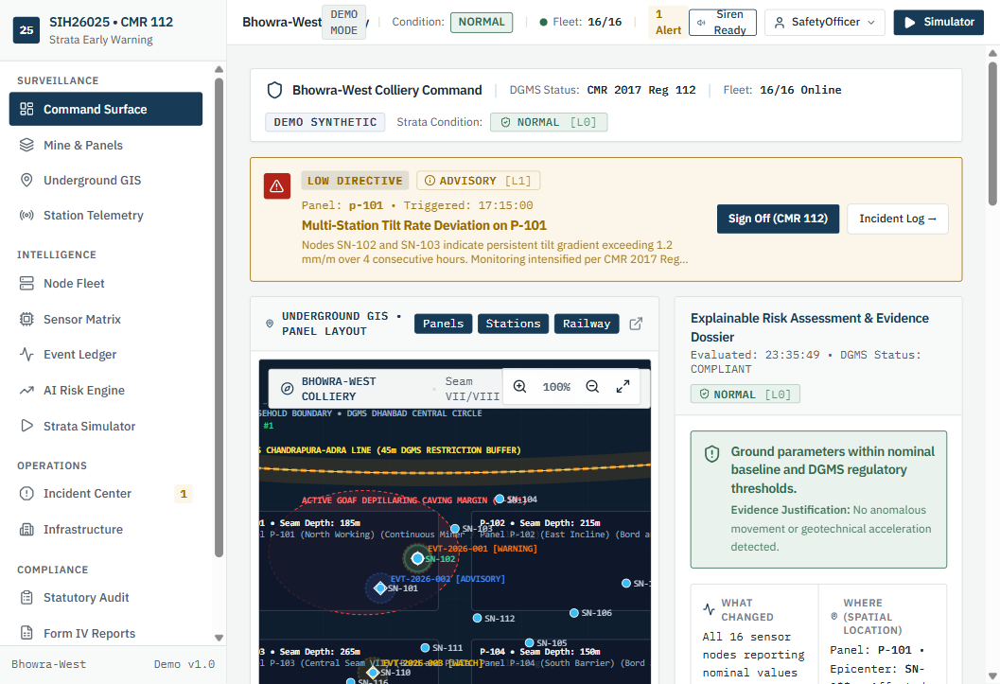
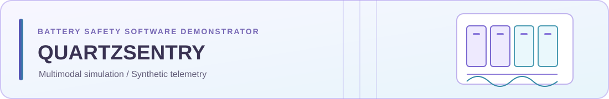
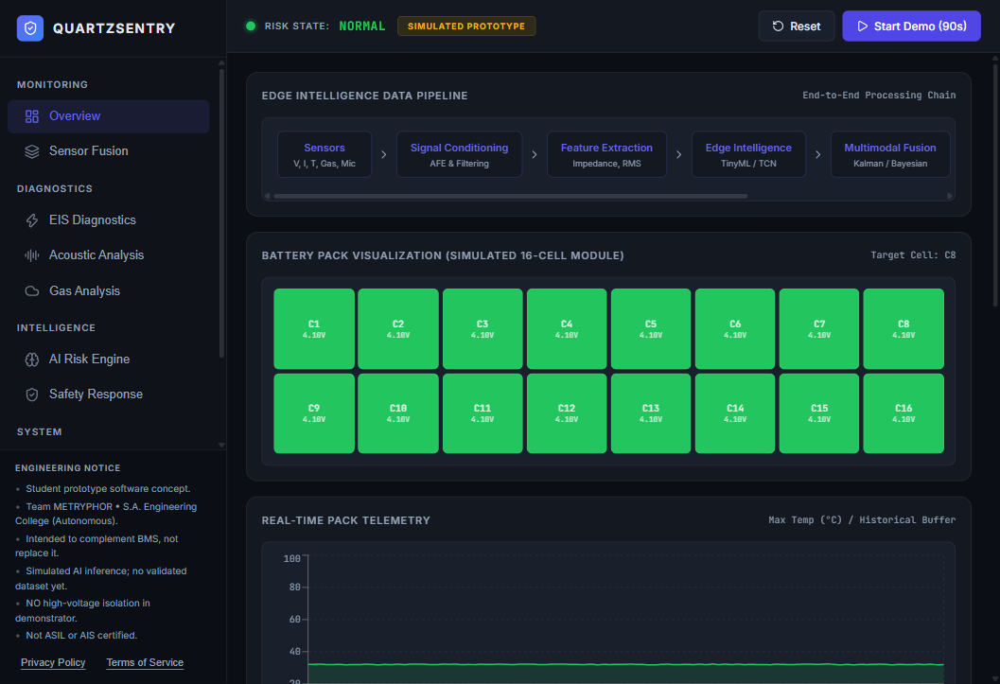
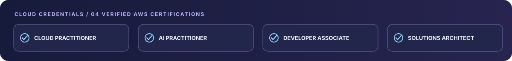

  <a href="https://www.linkedin.com/in/ron-rex">LinkedIn</a> ·
  <a href="https://www.credly.com/users/ronaldrex">AWS credentials</a> ·
  <a href="https://github.com/users/RONALD-REX-7/projects">Project boards</a> ·
  <a href="https://github.com/RONALD-REX-7">GitHub</a>

**ECE Undergraduate · Embedded Systems · Firmware · Industrial IoT**

*Practical engineering across electronics, reliable firmware, connected devices and edge intelligence.*

## 01 — Engineering profile

I’m an **Electronics and Communication Engineering undergraduate at S.A. Engineering College, Chennai**, graduating in **2028**. My primary direction is **embedded systems and microcontroller firmware**, supported by **Industrial IoT, cloud-connected systems and security**. I’m exploring **Edge AI and TinyML** for constrained devices.

I’m interested in engineering that connects software to physical behaviour: sensor integration, peripheral interfaces, firmware architecture, timing, fault handling, debugging and measurable verification.

### Engineering focus

| Core engineering | Supporting domains |
|:--|:--|
| Embedded C/C++, microcontroller firmware, sensor interfacing | Industrial IoT, telemetry and edge connectivity |
| ATmega328P, ESP32-S3, ARM Cortex-M concepts | Edge AI, TinyML and signal processing |
| GPIO, ADC, PWM, I2C, SPI, UART and real-time fundamentals | Cloud platforms, application security and CI |

**Evidence standard:** I distinguish physical hardware, software-tested systems and simulations. Synthetic telemetry is not field data; a browser simulator is not physical MCU validation.

## 02 — Featured engineering projects

Projects are ordered by relevance to my embedded-systems direction. The visuals below are custom project illustrations; photographs and application screenshots provide the actual project evidence.

### 01. LumaGuard

**PHYSICAL PROTOTYPE · STAGE 4 — HARDWARE BENCH TESTED**

**Context-aware micro-workspace proximity and hazard guard**

Arduino Nano (ATmega328P) · Embedded C/C++ · PlatformIO · HC-SR04 · IR flame sensor · SSD1306 OLED

- Physical breadboard prototype integrating ultrasonic proximity sensing, optical flame detection, local display and audible/visual alerts.
- Firmware implements proximity hysteresis, temporal candidate persistence, non-blocking scheduling, sensor-fault handling and EEPROM event counting.
- The repository documents nine end-to-end bench integration scenarios, including alert, silence, arming, hysteresis, echo-timeout and persistence checks.

[Source code and hardware documentation](https://github.com/RONALD-REX-7/LumaGuard)

---

### 02. EmbeddedLab OS

**SOFTWARE TESTED · STAGE 3 — VIRTUAL LABORATORY**

**Browser-based virtual embedded-systems laboratory**

Next.js · TypeScript · Zustand · Vitest · Supabase

- Interactive software models for GPIO, PWM, ADC and UART peripheral concepts.
- Guided laboratories, challenge-based learning and deterministic validation of simulated microcontroller states.
- **169 documented unit and integration tests.** This is an educational browser simulation—not a physical MCU emulator or hardware validation environment.

[Live demo](https://embeddedlab-os.vercel.app) · [Source repository](https://github.com/RONALD-REX-7/EmbeddedLab-OS)

---

### 03. MineGuard / SIH26025

**SOFTWARE PROTOTYPE · STAGE 2 — HARDWARE INTEGRATION INCOMPLETE**

**Edge-intelligence concept for mine subsidence monitoring and early warning**

ESP32-S3 firmware concepts · LoRa / IN865 architecture · TinyML methods · Next.js · Supabase

- Proposed multi-node monitoring architecture based on SIH 2026 problem statement SIH26025.
- Repository work includes system architecture, software components and a web telemetry prototype.
- The reported **93% recall** is from **1,000 synthetic test vectors**. It is not field performance or validation on deployed mine sensors.
- Physical sensing-node integration and field validation are not claimed as complete.

[Live demo](https://mineguard-sih26025.vercel.app) · [Source repository](https://github.com/RONALD-REX-7/sih26025)

---

### 04. QUARTZSENTRY

**SOFTWARE DEMONSTRATOR · STAGE 2 — PHYSICAL INTEGRATION INCOMPLETE**

**Multimodal early-warning demonstrator for lithium-ion battery thermal runaway**

React · Vite · TypeScript · SVG visualisation · accessibility

- Demonstrates software models for temperature, impedance, acoustic and off-gas precursor signals.
- Dashboard telemetry and sensor curves are **synthetic and generated in software**.
- No physical battery pack, integrated sensor front-end or certified battery protection system is claimed.

[Live demo](https://quartzsentry-prototype.vercel.app) · [Source repository](https://github.com/RONALD-REX-7/QUARTZSENTRY)

## 03 — Technical toolkit

| Domain | Tools and concepts |
|:--|:--|
| **Microcontrollers** | Arduino Nano / ATmega328P, ESP32-S3; ARM Cortex-M concepts |
| **Firmware** | Embedded C/C++, PlatformIO, state machines, interrupts, non-blocking scheduling, watchdogs, EEPROM |
| **Interfaces & connectivity** | GPIO, ADC, PWM, I2C, SPI, UART; LoRa / IN865 system concepts |
| **Edge intelligence** | MAD, EWMA, robust Z-score, sensor data analysis and TinyML exploration |
| **Cloud & application layer** | AWS, TypeScript, React, Next.js, Node.js, Supabase |
| **Quality & workflow** | Git, GitHub Actions, unit/integration testing, linting and technical documentation |

*Technologies listed are used in projects or actively studied; this does not imply equal proficiency across every item.*

## 04 — AWS certifications

- [AWS Certified Cloud Practitioner](https://www.credly.com/badges/9176f0c6-a291-4072-a332-55abd5c9b6f8)
- [AWS Certified AI Practitioner](https://www.credly.com/badges/42dd44ed-6a82-4ee9-8733-e7bc202223b9)
- [AWS Certified Developer – Associate](https://www.credly.com/badges/5e338e11-1247-412a-926c-031eb4d5e2a4)
- [AWS Certified Solutions Architect – Associate](https://www.credly.com/badges/b662ec17-f239-48bd-b5d9-a7685d13be7a)

[View all credentials on Credly](https://www.credly.com/users/ronaldrex)

## 05 — Additional engineering work

| Project | Scope and evidence | Repository |
|:--|:--|:--|
| **CLASSY_CS** | Academic evaluation, GPA/CGPA and admissions planning; repository documents 31 test assertions. | [Source](https://github.com/RONALD-REX-7/CLASSY_CS) |
| **ProblemChain / RUSH_HOUR_2026** | Collaborative civic-tech hackathon prototype. My documented repository contributions include scaffolding, security remediation, CI, TypeScript fixes and backend hardening; team contributions are distinguished in the project documentation. | [Source](https://github.com/RONALD-REX-7/RUSH_HOUR_2026) |
| **todo-rainmeter** | Maintained derivative Windows productivity skin using Rainmeter, Lua and PowerShell, with configurable UI and animation behaviour. | [Source](https://github.com/RONALD-REX-7/todo-rainmeter) |

## 06 — Education

**B.E. Electronics and Communication Engineering**  
S.A. Engineering College · Chennai, Tamil Nadu, India  
2024–2028 · Expected graduation: **May 2028**

## 07 — Connect

I’m interested in meaningful engineering opportunities involving **embedded firmware, electronics, IoT systems, edge computing and device security**.

<a href="https://www.linkedin.com/in/ron-rex">LinkedIn</a> ·
<a href="https://github.com/RONALD-REX-7">GitHub</a> ·
<a href="https://www.credly.com/users/ronaldrex">Credly</a> ·
<a href="https://skillsprofile.skillbuilder.aws/user/ron">AWS Skill Builder</a>

Lavender × signal blue · Engineering claims are scoped to documented evidence

