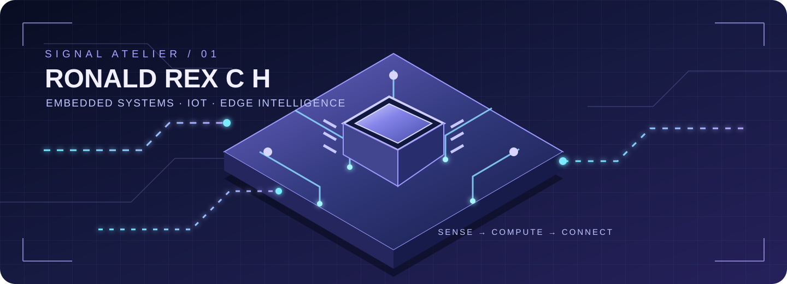
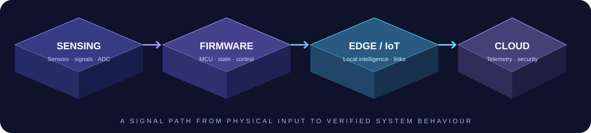
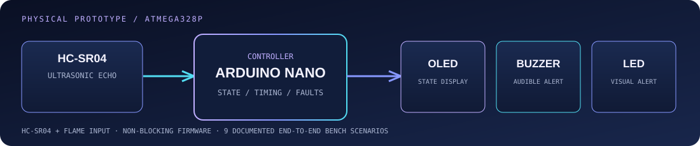
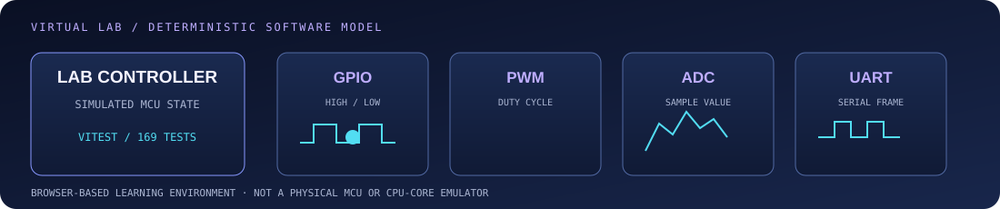
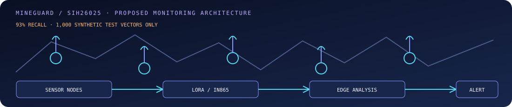
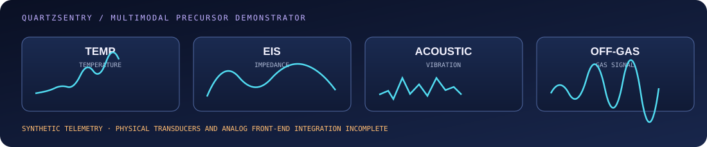
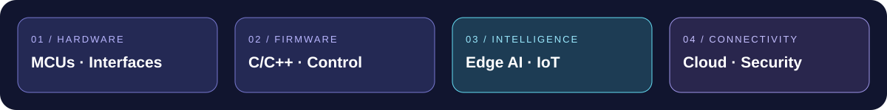

 

<a href="https://www.linkedin.com/in/ron-rex">LINKEDIN</a>　·　
<a href="https://www.credly.com/users/ronaldrex">AWS CREDENTIALS</a>　·　
<a href="https://skillsprofile.skillbuilder.aws/user/ron">AWS SKILL BUILDER</a>　·　
<a href="https://github.com/RONALD-REX-7">GITHUB</a>

# RONALD REX C H

**ELECTRONICS & COMMUNICATION ENGINEERING · CHENNAI · CLASS OF 2028**

*I build close to the hardware — sensing, firmware, connected systems and edge intelligence.*

---

## ◈ THE ENGINEERING PROFILE

ECE undergraduate at **S.A. Engineering College, Chennai**, focused on **embedded systems and microcontroller firmware**. My work connects physical sensing, peripheral interfaces, firmware behaviour, debugging and verification.

**Primary lane**　Embedded C/C++ · MCU fundamentals · Firmware architecture · Hardware bring-up  
**Connected lane**　Industrial IoT · Device security · Cloud telemetry · Edge AI / TinyML  
**Build philosophy**　Understand the signal. Control the state. Verify the behaviour.

---

## ◈ SELECTED BUILDS

Four engineering problems. Four different levels of implementation. The maturity labels are intentional: a software simulation is not a physical controller, synthetic telemetry is not field data, and a prototype is not a certified safety system.

### 01 / LumaGuard
**PHYSICAL PROTOTYPE · HARDWARE BENCH TESTED**

**Context-aware proximity and hazard guard**

Arduino Nano / ATmega328P · Embedded C/C++ · HC-SR04 · Flame sensor · SSD1306 OLED

- Physical breadboard prototype combining proximity sensing, flame detection, local display and audible/visual alerts.
- Firmware includes proximity hysteresis, temporal flame-candidate persistence, non-blocking scheduling, echo-fault handling and EEPROM event counting.
- **Nine end-to-end bench integration scenarios** documented in the project report.

[↗ Source code, pin mapping and test report](https://github.com/RONALD-REX-7/LumaGuard)

---

### 02 / EmbeddedLab OS
**SOFTWARE TESTED · VIRTUAL LABORATORY**

**A browser-based laboratory for embedded fundamentals**

Next.js · TypeScript · React · Zustand · Vitest · Supabase

- Interactive software models for GPIO, PWM, ADC and UART concepts.
- Guided laboratories, challenge-based learning and deterministic validation of simulated peripheral states.
- **169 documented Vitest tests.** This is an educational software simulation—not a physical MCU or CPU-core emulator.

[↗ Launch laboratory](https://embeddedlab-os.vercel.app)　·　[Source](https://github.com/RONALD-REX-7/EmbeddedLab-OS)

---

### 03 / MineGuard · SIH26025
**SOFTWARE PROTOTYPE · HARDWARE INTEGRATION INCOMPLETE**

**Edge-intelligence concept for mine subsidence monitoring**

ESP32-S3 concepts · LoRa / IN865 architecture · TinyML methods · Next.js · Supabase

- Multi-node monitoring architecture developed around Smart India Hackathon problem statement **SIH26025**.
- Repository includes system architecture, software components, firmware build work and a web telemetry demonstrator.
- **93% recall on 1,000 synthetic geotechnical test vectors**—not field performance or deployed-sensor validation.
- Hardware bench work is documented; full multi-sensor integration and field validation remain incomplete.

[↗ Demonstrator](https://mineguard-sih26025.vercel.app)　·　[Source](https://github.com/RONALD-REX-7/sih26025)

---

### 04 / QUARTZSENTRY
**SOFTWARE DEMONSTRATOR · PHYSICAL SENSOR INTEGRATION INCOMPLETE**

**Multimodal early-warning demonstrator for lithium-ion battery thermal runaway**

React · Vite · TypeScript · SVG signal visualisation

- Models temperature, electrochemical impedance, acoustic activity and off-gas precursor channels.
- Dashboard telemetry, Nyquist curves, acoustic values and gas readings are **synthetic software-generated signals**.
- Physical transducers and analogue front-end integration remain incomplete. Not a certified BMS or protection system.

[↗ Demonstrator](https://quartzsentry-prototype.vercel.app)　·　[Source](https://github.com/RONALD-REX-7/QUARTZSENTRY)

---

## ◈ OTHER WORK

| PROJECT | FOCUS | EVIDENCE |
|:--|:--|:--|
| **CLASSY_CS** | Academic evaluation, GPA/CGPA calculation and admissions-planning engines | 31 documented test assertions · [Repo](https://github.com/RONALD-REX-7/CLASSY_CS) |
| **ProblemChain / RUSH_HOUR_2026** | Collaborative civic-tech hackathon prototype; my documented work includes scaffolding, security remediation, CI, TypeScript fixes and backend hardening | [Contribution record](https://github.com/RONALD-REX-7/RUSH_HOUR_2026) |
| **todo-rainmeter** | Windows productivity skin using Rainmeter, Lua and PowerShell | [Repo](https://github.com/RONALD-REX-7/todo-rainmeter) |

---

## ◈ TOOLKIT

| LAYER | TOOLS & CONCEPTS |
|:--|:--|
| **MCUs & electronics** | Arduino Nano / ATmega328P, ESP32-S3, ARM Cortex-M concepts |
| **Firmware** | Embedded C/C++, PlatformIO, state machines, non-blocking scheduling, interrupts, EEPROM |
| **Interfaces** | GPIO, ADC, PWM, I2C, SPI, UART, LoRa / IN865 concepts |
| **Edge intelligence** | Python, sensor-data analysis, MAD, EWMA, robust Z-score, TinyML exploration |
| **Cloud & application** | AWS, TypeScript, React, Next.js, Node.js, Supabase |
| **Workflow** | Git, GitHub Actions, testing, linting, Linux, Docker, technical documentation |

Tools are not all at the same proficiency level; some are active learning areas.

---

## ◈ AWS CERTIFICATIONS

- [AWS Certified Cloud Practitioner](https://www.credly.com/badges/9176f0c6-a291-4072-a332-55abd5c9b6f8)
- [AWS Certified AI Practitioner](https://www.credly.com/badges/42dd44ed-6a82-4ee9-8733-e7bc202223b9)
- [AWS Certified Developer – Associate](https://www.credly.com/badges/5e338e11-1247-412a-926c-031eb4d5e2a4)
- [AWS Certified Solutions Architect – Associate](https://www.credly.com/badges/b662ec17-f239-48bd-b5d9-a7685d13be7a)

[View credential portfolio ↗](https://www.credly.com/users/ronaldrex)

---

## ◈ GITHUB SIGNAL

| MILESTONE | RECORD |
|:--|:--:|
| Pull Shark — Bronze | 34 merged PRs |
| Pair Extraordinaire | 10 co-authored PRs |
| Galaxy Brain | 4 active solutions |
| YOLO · Quickdraw | Unlocked |
| Releases & packaging | 4 published releases |
| GitHub Pro | Active |

---

## ◈ EDUCATION & PRINCIPLES

**B.E. Electronics and Communication Engineering**  
S.A. Engineering College · Chennai, Tamil Nadu, India  
2024–2028 · Expected graduation: **May 2028**

- **Understand before abstracting.** Know what the sensor, peripheral or interface is doing.
- **Verify the boundary.** Separate a successful build, passing software test, bench-tested circuit and field-validated system.
- **Design for failure.** Timeouts, stale data, invalid states and recovery paths deserve explicit treatment.
- **Document for the next engineer.** Reproducible steps and honest limitations are part of the system.

Interested in collaborations involving **embedded firmware, electronics, IoT, edge computing and device security**.

<a href="https://www.linkedin.com/in/ron-rex">LINKEDIN</a>　·　
<a href="https://github.com/RONALD-REX-7">GITHUB</a>　·　
<a href="https://www.credly.com/users/ronaldrex">CREDLY</a>　·　
<a href="https://skillsprofile.skillbuilder.aws/user/ron">AWS SKILL BUILDER</a>

DESIGNED IN LAVENDER × SIGNAL BLUE · BUILT CLOSE TO THE HARDWARE

